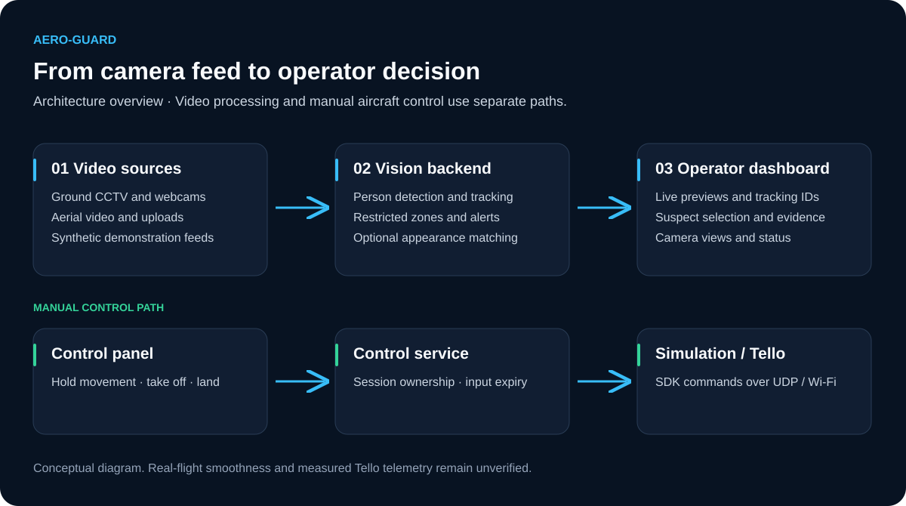
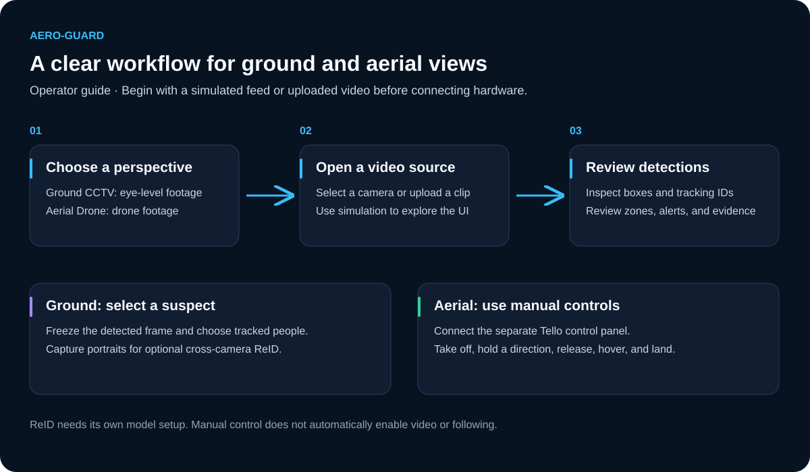

<div align="center">

# AERO-GUARD

**Person Detection · Multi-Camera Tracking · Aerial Monitoring**

A tactical dashboard connecting ground-camera intelligence with aerial video and manual drone control.

[Getting Started](#getting-started) · [Capabilities](#capabilities) · [Documentation](#documentation)

</div>

---

## Overview

AERO-GUARD brings video monitoring, person detection, suspect selection, and aerial workflows into one interface. A FastAPI vision engine processes camera feeds while a Next.js dashboard provides live views, tracking overlays, alerts, and operator controls.



*System overview diagram.* Camera footage passes through detection and tracking before reaching the dashboard. Manual flight commands follow a separate path through the control service to simulation or a Wi-Fi-connected Tello.

Two dedicated perspectives keep the workflows clear:

| Ground CCTV | Aerial Drone |
| --- | --- |
| Webcam, IP camera, and uploaded footage | Aerial footage, supported live sources, and simulation |
| Eye-level person detection and tracking | Detection profiles for aerial scenes |
| Frozen-frame suspect selection | Optional ground-to-aerial appearance matching |
| Restricted-zone monitoring | Separate Tello manual control panel |

## Capabilities

- **Person detection and tracking** — bounding boxes, confidence scores, and tracking IDs.
- **Live monitoring** — MJPEG previews, WebSocket updates, and isolated camera channels.
- **Suspect workflows** — freeze a ground frame, select tracked people, and capture portraits.
- **Optional re-identification** — appearance matching across ground and aerial views using X-TFCLIP.
- **Incident evidence** — restricted zones, intrusion alerts, snapshots, and recordings.
- **Tello controls** — connect, take off, move, rotate, hover, land, and disconnect.
- **Simulation and video testing** — explore workflows before connecting hardware.

## System Design

The backend handles video acquisition, inference, tracking, and evidence. The frontend displays previews and status, while dedicated API requests handle operator actions. Optional ReID compares appearance across camera views; it does not command the aircraft to follow a person.

| Layer | Technologies |
| --- | --- |
| Dashboard | Next.js 16, React, TypeScript, Tailwind CSS |
| Application state | Redux Toolkit, TanStack Query |
| Vision backend | Python, FastAPI, OpenCV, Ultralytics |
| Detection profiles | YOLO26n / ByteTrack; YOLO11n VisDrone / BoT-SORT |
| Verification | pytest, Vitest, Testing Library, Playwright |

## Getting Started

**Requirements:** Python 3.12, Node.js 20.9+, and npm. Initial installation and model downloads require internet access.

### 1. Start the backend

Run from the repository root on macOS or Linux:

```sh
cd backend
python3 -m venv .venv
source .venv/bin/activate
python -m pip install -r requirements-test.txt
cp .env.example .env
```

Set `REID_ENABLED=false` in `.env` for an initial detection-only setup. Enable it after completing the [ReID installation](docs/person-reidentification.md).

```sh
python scripts/download_models.py
python -m uvicorn main:app --host 127.0.0.1 --port 8000
```

<details>
<summary>Windows PowerShell setup</summary>

```powershell
cd backend
py -3.12 -m venv .venv
.\.venv\Scripts\Activate.ps1
python -m pip install -r requirements-test.txt
Copy-Item .env.example .env
```

Configure `.env`, then run the same model-download and Uvicorn commands shown above.

</details>

### 2. Start the dashboard

In a separate terminal, from the repository root:

```sh
cd frontend
npm ci
npm run dev
```

| Service | Local address |
| --- | --- |
| Dashboard | <http://127.0.0.1:3000> |
| Interactive API docs | <http://127.0.0.1:8000/docs> |

### 3. Open a feed

Choose **Ground CCTV** or **Aerial Drone**, then select a source or upload a video. Use a synthetic feed to explore the interface. Ground feeds support frozen-frame suspect selection; cross-camera matching requires the optional ReID module.



*Operator workflow diagram.* Start by choosing the camera perspective and source. Ground operators can freeze a detected frame and select suspects. Aerial operators use the separate manual control panel for movement and landing.

## Tello Manual Control

The manual panel starts in **simulation mode**. To connect a real Tello:

1. Connect the backend computer to the drone's Wi-Fi network and close competing control apps.
2. Set `DRONE_CONTROL_MODE=tello` in `backend/.env`.
3. Restart the backend with one worker and select **Connect controls** with the aircraft on the ground.

SDK acknowledgment confirms the control connection. The manual panel supports held movement, rotation, hover, takeoff, and landing; older mission controls use simulated avionics.

> **Development status:** real-flight smoothness remains unverified. Control state is command-derived; Tello video, measured telemetry, and autonomous following are separate integrations. Automated tests use a local UDP emulator.

See the [Tello control guide](docs/tello-manual-control.md) for connection settings and operating limitations.

## Configuration

| Location | Purpose |
| --- | --- |
| `backend/.env` | Model profiles, devices, playback, ReID, and Tello settings |
| `backend/app/core/` | Shared backend configuration and constants |
| `backend/models/registry.json` | Detection checkpoints and verification metadata |
| `frontend/src/constants/` | Deployment defaults, network paths, and UI tokens |

Set `BACKEND_ORIGIN` for a different backend address. Keep credentials in local environment configuration. Optional external services need separate setup.

Preview and inference rates depend on hardware. Playback can skip source frames when processing falls behind; confidence scores and synthetic demonstrations are not accuracy benchmarks.

## Development Checks

**Backend** — with the virtual environment active, from `backend`:

```sh
python -m pytest tests -q
```

**Frontend** — from `frontend`:

```sh
npm test
npx tsc --noEmit
npm run lint
npm run build
npm run test:e2e
```

Browser tests use Chrome by default and start isolated local servers. Integration tests require local socket access. Production builds fetch the configured Google Fonts; browser tests use an offline font fixture.

## Repository Layout

```text
backend/
├── app/api/          HTTP and WebSocket endpoints
├── app/core/         Configuration and paths
├── app/schemas/      Shared request and response contracts
├── app/services/     Vision, streaming, tracking, alerts, and drone control
├── models/           Checkpoint registry
└── tests/            Unit and integration tests
frontend/
├── src/components/   Dashboard components
├── src/hooks/        State and interaction workflows
├── src/services/     API clients and queries
├── src/types/        Shared TypeScript contracts
├── src/constants/    Network and visual configuration
├── src/utils/        Reusable domain logic
└── tests/            Unit, architecture, and browser tests
docs/                 Setup and workflow guides
```

## Documentation

| Guide | Contents |
| --- | --- |
| [Video and suspect selection](docs/video-testing-and-suspect-selection.md) | Uploads, playback, and frozen-frame selection |
| [Detection models](backend/models/README.md) | Checkpoints, profiles, and trackers |
| [Person re-identification](docs/person-reidentification.md) | X-TFCLIP setup and cross-camera matching |
| [Tello manual control](docs/tello-manual-control.md) | Simulation, Wi-Fi connection, and control behavior |
| [System documentation](docs/AERO_GUARD_SYSTEM_DOCUMENTATION.md) | Broader project architecture |
| [Engineering guidelines](AGENTS.md) | Repository conventions |
